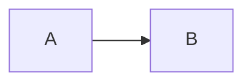

# In-Neovim TUI Preview Implementation Plan

> **For Hermes:** Use subagent-driven-development skill to implement this plan task-by-task.

**Goal:** Add mdmaid.nvim commands that render Markdown + Mermaid directly inside Neovim using mdmaid's new TUI/ASCII backend, while keeping the existing browser preview intact.

**Architecture:** Treat browser preview and terminal/inline preview as sibling viewers. Browser preview continues to use `mdmaid serve`. TUI preview calls mdmaid CLI/API commands that render Markdown or one Mermaid block to terminal text, then displays the result in a Neovim terminal split, scratch buffer, floating window, or virtual lines.

**Tech Stack:** Neovim Lua, existing mdmaid.nvim config/session modules, mdmaid CLI, Veol-backed TUI renderer in mdmaid, optional `beautiful-mermaid` fallback through mdmaid.

---

## Why this belongs in mdmaid.nvim

The current plugin is excellent when a browser is available. But many real workflows happen inside remote terminals:

- Editing docs over SSH.
- Using Termius from iPad/Mac.
- Working inside tmux.
- Reviewing agent-generated Markdown without opening a browser.
- Quickly inspecting the current Mermaid block while staying in the editor.

The plugin should therefore provide two first-class preview modes:

- **Web preview:** high-fidelity browser rendering, almost as it exists now.
- **TUI preview:** terminal-native Markdown + Mermaid ASCII, works over SSH.

---

## Proposed user UX

Commands:

```vim
:MdmaidPreview          " existing browser preview
:MdmaidPreviewWeb       " explicit browser preview alias
:MdmaidPreviewTui       " full current buffer in Neovim terminal/scratch/floating view
:MdmaidRenderDiagram    " render Mermaid block under cursor to floating window
:MdmaidToggleInline     " show/hide ASCII Mermaid under current block via virtual lines
```

Keymaps:

```lua
keymaps = {
  preview = "<leader>mp",      -- existing browser preview
  preview_tui = "<leader>mt",  -- full document TUI preview
  diagram = "<leader>md",      -- current Mermaid block floating preview
  inline = "<leader>mi",       -- toggle inline ASCII under block
}
```

Config:

```lua
require("mdmaid").setup({
  preview = {
    open_browser = true,
    browser = nil,
    default_viewer = "web", -- web | tui | auto
  },

  tui = {
    enabled = true,
    mode = "float", -- float | split | tab | terminal
    backend = "auto", -- auto | veol | beautiful-mermaid | source
    width = nil, -- nil = current window width
    height = 0.8,
    border = "rounded",
    refresh_on_save = true,
    mdmaid_args = {},
  },

  keymaps = {
    preview = "<leader>mp",
    preview_tui = "<leader>mt",
    diagram = "<leader>md",
    inline = "<leader>mi",
  },
})
```

---

## Dependency expectations

mdmaid.nvim should not call Veol directly. It should call mdmaid, and mdmaid chooses:

1. Veol CLI.
2. `beautiful-mermaid` fallback.
3. Raw source fallback.

This keeps Mermaid renderer policy in one place and makes the Neovim plugin thinner.

Health check should report:

```text
mdmaid CLI: found / not found
mdmaid tui command: supported / unsupported
veol: found / not found
beautiful-mermaid fallback: available through mdmaid / unknown
```

---

## Task 1: Extend configuration schema

**Objective:** Add TUI preview config without changing browser defaults.

**Files:**

- Modify: `lua/mdmaid/config.lua`
- Modify: `README.md`
- Modify: `doc/mdmaid.txt`

**Steps:**

1. Add `preview.default_viewer` defaulting to `"web"`.
2. Add `tui` table defaults.
3. Add new keymap defaults for `preview_tui`, `diagram`, and `inline`.
4. Ensure existing user configs continue to merge correctly.

**Verification:**

```vim
:lua print(vim.inspect(require('mdmaid.config').get().tui))
```

Expected: TUI defaults are present and browser config remains unchanged.

---

## Task 2: Add CLI command helpers

**Objective:** Centralize calls to mdmaid TUI commands.

**Files:**

- Create: `lua/mdmaid/tui.lua`
- Modify: `lua/mdmaid/init.lua`

**Functions:**

```lua
M.render_file(path, opts, cb)
M.render_buffer(bufnr, opts, cb)
M.render_mermaid_block(code, opts, cb)
```

**Implementation notes:**

- Use `vim.system` on Neovim 0.10+ and `vim.fn.jobstart` fallback for 0.9.
- Pass Markdown through stdin for unsaved buffers.
- Use configured `mdmaid_path`.
- Call:

```bash
mdmaid tui - --backend auto --width <cols>
mdmaid render-mermaid - --format ascii --backend auto --width <cols>
```

- Return stdout/stderr/exit code to callback.
- Never block UI.

**Verification:**

Run a headless Lua smoke test that calls `render_mermaid_block('graph LR\nA-->B')` and asserts stdout is non-empty.

---

## Task 3: Add full-document TUI viewer

**Objective:** Display rendered Markdown in Neovim.

**Files:**

- Create: `lua/mdmaid/tui_view.lua`
- Modify: `plugin/mdmaid.lua`
- Modify: `lua/mdmaid/init.lua`

**Viewer modes:**

- `float`: scratch floating buffer with rendered text.
- `split`: horizontal split scratch buffer.
- `tab`: new tab scratch buffer.
- `terminal`: terminal buffer running `mdmaid tui <file>` for pager-like behavior.

**Initial implementation recommendation:** start with `float` and `split`; add `terminal` later if needed.

**Command:**

```vim
:MdmaidPreviewTui
```

**Verification:**

1. Open a Markdown file with a Mermaid block.
2. Run `:MdmaidPreviewTui`.
3. Confirm rendered text appears inside Neovim.
4. Confirm no browser opens.

---

## Task 4: Render current Mermaid block in a floating window

**Objective:** Let users preview the diagram under cursor without rendering the whole file.

**Files:**

- Create: `lua/mdmaid/mermaid_block.lua`
- Modify: `lua/mdmaid/tui_view.lua`
- Modify: `plugin/mdmaid.lua`

**Implementation notes:**

- Detect fenced blocks with languages:
  - `mermaid`
  - `mmd`
  - `mermaid-js`
- From cursor position, scan up to opening fence and down to closing fence.
- Extract code between fences.
- Call `mdmaid render-mermaid - --format ascii`.
- Display result in a floating scratch buffer.

**Command:**

```vim
:MdmaidRenderDiagram
```

**Verification:**

Place cursor inside:

````markdown

````

Run `:MdmaidRenderDiagram` and confirm ASCII diagram appears.

---

## Task 5: Add inline/virtual-lines preview

**Objective:** Show ASCII diagrams directly below the source block while preserving the Markdown source.

**Files:**

- Create: `lua/mdmaid/inline.lua`
- Modify: `lua/mdmaid/init.lua`
- Modify: `plugin/mdmaid.lua`

**Implementation notes:**

- Use extmarks with virtual lines when available.
- Namespace: `mdmaid_inline`.
- Toggle per-buffer.
- Cache render result by block range + content hash.
- Clear extmarks on buffer changes or toggle off.
- Do not modify the file.

**Command:**

```vim
:MdmaidToggleInline
```

**Verification:**

1. Toggle inline preview on.
2. Confirm ASCII appears below Mermaid fences.
3. Edit the block and save.
4. Confirm preview refreshes or is invalidated.
5. Toggle off and confirm extmarks disappear.

---

## Task 6: Add health checks

**Objective:** Make setup failures obvious.

**Files:**

- Modify: `lua/mdmaid/health.lua`

**Checks:**

- `mdmaid` executable exists.
- `mdmaid --version` or equivalent works.
- `mdmaid tui -` exists and returns output for a tiny Markdown sample.
- `mdmaid render-mermaid - --format ascii` returns output for `graph LR; A-->B`.
- Report `veol` presence as informational if available.

**Verification:**

```vim
:checkhealth mdmaid
```

Expected: TUI capability section appears with actionable install hints.

---

## Task 7: Update docs

**Objective:** Explain web vs TUI preview clearly.

**Files:**

- Modify: `README.md`
- Modify: `doc/mdmaid.txt`

**Docs must include:**

- Browser mode = high fidelity.
- TUI mode = terminal/SSH/Termius/nvim native.
- Veol install note belongs mostly to mdmaid, but mdmaid.nvim should mention it indirectly:

```text
For broad Mermaid ASCII support, install mdmaid with its TUI backend and Veol available on PATH.
```

- Command examples.
- Keymap examples.
- Limitations: TUI output is approximate ASCII/Unicode, not pixel-perfect Mermaid.

---

## Open questions

1. Should `:MdmaidPreview` use `preview.default_viewer`, or stay web-only for compatibility?
2. Should TUI preview use a terminal buffer running `mdmaid tui` or capture output into a scratch buffer by default?
3. Should inline preview auto-render all diagrams or only the current block?
4. Should failed diagrams show stderr, raw source, or both?

---

## Acceptance criteria

- Existing browser preview commands remain compatible.
- `:MdmaidPreviewTui` renders the current Markdown buffer inside Neovim without opening a browser.
- `:MdmaidRenderDiagram` renders the current Mermaid fence as ASCII in a floating window.
- `:MdmaidToggleInline` can show/hide rendered ASCII below Mermaid blocks without modifying the file.
- Health check reports TUI readiness.
- Workflow works over SSH/Termius as long as mdmaid CLI is installed remotely.
